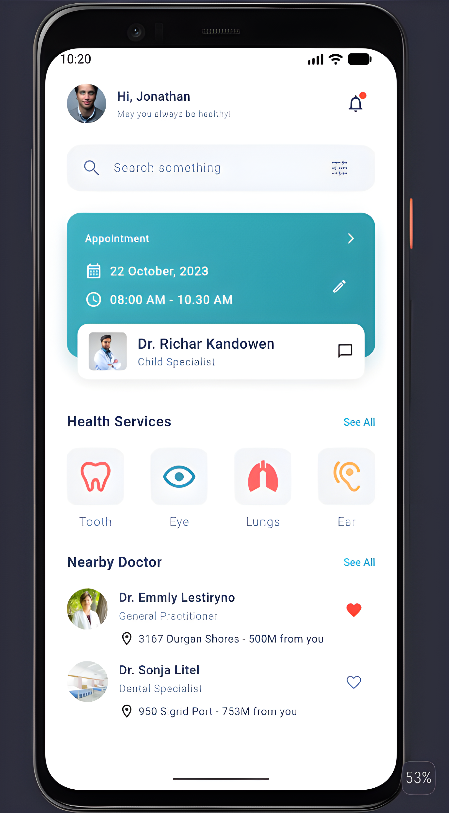
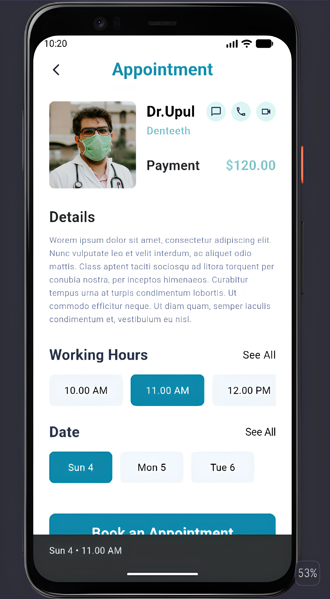

# Medical Appointment REST API

<table align="center">
  <tr>
    <td align="center">
      
    </td>
    <td align="center">
      
    </td>
  </tr>
</table>

## Overview

Medical Appointment REST API is a cross-platform mobile application built with Flutter that lets
users browse doctors, book medical appointments, and manage their healthcare schedule. The data is
no longer read from a local file: it is fetched from a REST API over HTTP, decoded from JSON, and
delivered to the UI through a Clean Architecture split into Presentation, Domain and Data layers.

## Features

- **REST API Integration**: The home feed and the appointment details are loaded from a remote
  service with HTTP `GET` requests, both executed in parallel.
- **JSON Serialization**: The JSON responses are decoded and validated in dedicated models
  (`AppDataModel`, `DoctorModel`) that convert them into domain entities.
- **Clean Architecture**: Presentation, Domain and Data layers with a one-way dependency, so the UI
  never talks to the HTTP client directly.
- **Loading and Error Handling**: Explicit `loading`, `success`, `empty` and `error` states, a
  request timeout, an HTTP status check, and a **Try again** button on failure.
- **Search, Filter and Sort**: Search doctors by name or specialty, filter by all doctors or
  favorites, and sort by name or specialty.
- **Appointment Booking**: Pick a working hour and a date, then confirm the booking with a single
  tap.
- **Reusable UI Components**: The same design as the previous laboratory works, built from
  separate widgets for the header, search bar, services, doctor tiles and appointment sections.

## Technologies

- **Framework**: Flutter
- **Language**: Dart
- **Architecture**: Clean Architecture (Presentation, Domain, Data)
- **State Management**: flutter_bloc (Cubit)
- **Networking**: http
- **UI Toolkit**: Material Design 3
- **Libraries**: flutter_bloc, flutter_svg, http
- **Development Tools**: Android Studio
- **Version Control**: Git, GitHub

## Project Structure

```
lib/
├── main.dart
├── app.dart
├── core/
│   ├── constants/
│   │   └── app_colors.dart
│   └── widgets/
│       └── data_image.dart
├── data/
│   ├── datasources/
│   │   └── app_remote_data_source.dart
│   ├── models/
│   │   ├── app_data_model.dart
│   │   └── doctor_model.dart
│   └── repositories/
│       └── app_repository_impl.dart
├── domain/
│   ├── entities/
│   │   ├── app_data.dart
│   │   └── doctor.dart
│   ├── repositories/
│   │   └── app_repository.dart
│   └── usecases/
│       └── load_app_data.dart
└── presentation/
    ├── screens/
    │   ├── home/
    │   │   └── home_screen.dart
    │   └── appointment/
    │       └── appointment_details_screen.dart
    ├── state/
    │   ├── app_cubit.dart
    │   ├── app_state.dart
    │   └── load_status.dart
    └── widgets/
        ├── common/
        │   └── section_title.dart
        ├── home/
        │   ├── home_header.dart
        │   ├── search_bar.dart
        │   └── health_services.dart
        ├── doctor/
        │   └── doctor_tile.dart
        └── appointment/
            ├── appointment_card.dart
            ├── appointment_header.dart
            ├── appointment_doctor_info.dart
            ├── working_hours.dart
            ├── appointment_dates.dart
            ├── edit_button.dart
            └── book_appointment_button.dart
```

## Clean Architecture

The dependencies point only inwards: Presentation and Data depend on Domain, and Domain depends on
nothing.

| Layer | Contents | Role |
|---|---|---|
| **Presentation** | Screens, widgets, `AppCubit`, `AppState` | Displays the data and handles user actions |
| **Domain** | Entities, `AppRepository` (abstract), `LoadAppData` use case | Business rules and contracts, independent of Flutter and HTTP |
| **Data** | `AppRemoteDataSource`, models, `AppRepositoryImpl` | Makes the HTTP requests and converts JSON into entities |

### Data Flow

```
 UI (HomeScreen)
      │  load()
      ▼
  AppCubit ──► LoadAppData (use case) ──► AppRepository (interface)
                                                │
                                                ▼
                                       AppRepositoryImpl
                                                │
                                                ▼
                                       AppRemoteDataSource ──► HTTP GET ──► REST API
                                                │
                                                ▼  JSON
                                          AppDataModel
                                                │
                                                ▼  AppData (entity)
  AppState ◄── emit(success / error) ◄──────────┘
      │
      ▼
 BlocBuilder rebuilds the UI
```

## REST API

Base URL: `https://test-api-jlbn.onrender.com/lab2026/v2`

| Method | Endpoint | Description |
|---|---|---|
| `GET` | `/feed` | Home data: user, notifications, search, appointment, health services, nearby doctors |
| `GET` | `/feed/details` | Appointment details: doctor, payment, details, working hours, dates, actions |

Both requests are sent in parallel with `Future.wait`, use the `Accept: application/json` header,
have a 60 second timeout, and fail with an exception if the status code is not `200`.

## Resources

- [Learn Flutter](https://docs.flutter.dev/get-started/learn-flutter)
- [Flutter networking and HTTP](https://docs.flutter.dev/cookbook/networking/fetch-data)
- [JSON and serialization in Flutter](https://docs.flutter.dev/data-and-backend/serialization/json)
- [http package](https://pub.dev/packages/http)
- [flutter_bloc package](https://pub.dev/packages/flutter_bloc)

## Installation

To install and run the application, follow these steps:

1. **Clone this repository:**
```bash
git clone https://github.com/Constantin-Stamate/medical-appointment-rest-api
```

2. **Navigate to the project directory:**
```bash
cd medical-appointment-rest-api
```

3. **Install dependencies:**
```bash
flutter pub get
```

4. **Run the application** (an internet connection is required):
```bash
flutter run
```

## Contributors

**Medical Appointment REST API** was developed as part of the Mobile Application Development
laboratory works.

- GitHub: [Constantin-Stamate](https://github.com/Constantin-Stamate)
- Email: constantinstamate.r@gmail.com